# ScoutSuite fork modernization baseline

Assessment date: **2026-10-30**. Source revision: **7909f2fc6186063e5c9e7ddef8c4d7d1072c8f3d**, dated 2024-05-10; package version **5.14.0**. The working tree was clean at the start. This assessment adds documentation and repository rules only.

Read next: [prioritized roadmap](ROADMAP.md), [offline results and reproduction](OFFLINE_VALIDATION.md), [AWS API inventory](AWS_API_INVENTORY.md), and [development rules](../../AGENTS.md).

## Assessment scope and confidence

Reviewed the CLI/lifecycle, shared provider/resource abstractions, AWS facades and selected normalizers, AWS rule catalog, Azure/GCP authentication and adapter boundaries, dependency declarations, tests, workflows, Docker packaging, and report encoders/templates/assets. Findings below distinguish static observations, reproduced failures, and proposed improvements. This is an engineering baseline, not a completed vulnerability audit, standards certification, exhaustive AWS deprecation inventory, or live-cloud compatibility certification.

No cloud account was contacted, no cloud CLI or scanner run was executed, and no production credentials or customer assessment data were used. Tests used repository unit fixtures and mocks with external sockets, unmocked botocore operations, and subprocesses blocked. Loopback was allowed for Windows asyncio's internal socket pair. Public documentation and package downloads were used separately from test execution. Azure/GCP service collection and browser behavior have not been dynamically certified.

## Repository inventory

Static counts describe files and configured rule keys, not effective service coverage or enabled rule instances.

| Component | Baseline |
| --- | --- |
| Application Python | 504 files, 21,927 lines under `ScoutSuite/` |
| Tests | 13 `test_*.py` modules, 52 test methods; 6 are async methods in ordinary `unittest.TestCase` |
| AWS | 160 Python files; 147 finding files and 147 default ruleset keys |
| Azure | 103 Python files; 81 finding files and 81 default ruleset keys |
| GCP | 89 Python files; 119 finding files and 119 default ruleset keys |
| Other providers | Aliyun 18, OCI 10, Kubernetes 174, DigitalOcean 29 finding files; default key counts 18/10/129/27 respectively |
| Assets | 633 JSON files under `ScoutSuite/`, all parse; bundled `includes.zip` passes CRC validation |
| Dependencies | 49 runtime requirement entries; 7 development entries plus recursive runtime requirements; no committed lock/constraints file |
| Build metadata | `setup.py` + `MANIFEST.in`; no `pyproject.toml` or `python_requires` |

## Architecture and technical debt

```mermaid
flowchart LR
    CLI[CLI or programmatic run] --> AUTH[Authentication strategy]
    AUTH --> PROVIDER[Provider and service configuration]
    PROVIDER --> FACADE[SDK facade]
    FACADE --> RESOURCES[Mutable resource dictionaries]
    RESOURCES --> PRE[Provider preprocessing]
    PRE --> RULES[JSON rules and recursive processing engine]
    RULES --> POST[Filters, exceptions and postprocessing]
    POST --> REPORT[HTML plus JavaScript results or SQLite]
    REPORT --> VIEWER[Browser and optional CherryPy API]
```

The provider/facade/resource separation and data-driven rule engine are useful seams for incremental work. Preserve them. The main debt is implicit contracts and state shared across collection, analysis, and presentation.

| Area / evidence | Observed behavior and consequence | Roadmap |
| --- | --- | --- |
| `ScoutSuite/__main__.py::run`, `_run` | Long provider-specific parameter list; mutable default lists; synchronous wrapper owns/closes the current event loop; no clear async embedding contract. `collections.Callable` is monkeypatched at import. | M03 |
| `__main__.py::_run` local path | Authentication, provider construction, and report setup happen before `fetch_local` is checked. `--local` is not an offline boundary. | M01, M03 |
| `providers/utils.py` | Shared helpers use a custom `loop.throttler`, thread executor, task sets and `asyncio.wait`; retry/backoff code is commented out. `map_concurrently` suppresses task exceptions. Task creation is not bounded by `max_workers`. | M03, M04 |
| `providers/base/services.py`, `resources/base.py` | Broad exception logging permits continuation with incomplete inventories. Many facades return `[]`/`{}` after errors, indistinguishable from genuinely empty resources. | M04 |
| `core/processingengine.py` | Rule exceptions fall back to zero checked/flagged items. A report can appear clean when a rule did not evaluate. Missing/incomplete/not-applicable must become observable states. | M04, M08 |
| `providers/base/provider.py`, `core/utils.py`, `metadata.json` | Nested dictionaries, dotted paths, runtime callbacks and reflection bind collectors, rules, counts, links and templates. There is no explicit versioned normalized-result schema. | M04, M09 |
| `aws/facade/utils.py::get_client` | Process-wide cache keys only `(service, region)`, excluding session/account; `setdefault` eagerly constructs a new client even on a hit. Risks stale/wrong-session reuse in embedded or multi-account execution. Static observation; no account switching was tested. | M04 |
| `ScoutSuite/__init__.py`, `output/result_encoder.py` | Global `ERRORS_LIST`; JSON serialization deletes provider attributes (`credentials`, `profile`, etc.) while encoding. Output generation mutates application state. | M03, M09 |
| `providers/__init__.py`, authentication factory | Providers load dynamically, but shared conditions import AWS `policyuniverse` and the monolithic installation requires all providers' SDKs. Dependency isolation needs more than extras declarations. | M02, M07 |

## Runtime, dependencies and packaging

The classifiers and CI name Python 3.9/3.10/3.11. The Docker base is `python:3.12`, which has no matching test gate. As of this assessment, Python 3.9 and 3.10 are end-of-life; 3.11 is security-maintained through October 2027. Python 3.15 was released in October 2026. Adopt a staged, explicit matrix instead of claiming all future `3.11+` versions are already supported. [Python lifecycle](https://devguide.python.org/versions/).

Python 3.14 changes `asyncio.get_event_loop()` to raise when no current loop exists. The current synchronous entry point calls it before the closed-loop fallback, so this is a concrete compatibility hazard. Existing-loop embedding and repeated runs also need tests on 3.11. [Python event-loop contract](https://docs.python.org/3.14/library/asyncio-eventloop.html).

| Dependency group | Evidence | Modernization decision |
| --- | --- | --- |
| Development tools | `dev-requirements.txt:6` contains **`pytest>=5.*`**, rejected by modern `packaging.Requirement`. `mypy` is installed but never run. Tool versions are otherwise unbounded. | Fix specifier first; resolve reproducible tool constraints and introduce scoped lint/type gates. |
| Shared runtime | `python-dateutil<2.8.1,>=2.1`, `coloredlogs<=10.0`, `asyncio-throttle==0.1.1`; unbounded CherryPy, sqlitedict, netaddr. | Review why caps exist; upgrade independently with conditions/date/console/serialization tests. Do not infer vulnerabilities solely from age. |
| AWS SDK | `boto3>=1.9.210`, `botocore>=1.20.21` are old floors with no tested upper range or resolved snapshot. | Validate a mutually compatible recent SDK pair and paginator/operation models; test selected minimum and current constraints. Let boto3's botocore compatibility requirement govern the pair. |
| IAM policy data | `policyuniverse>=1.3.2.0`; installed baseline snapshot resolves to `1.5.1.20231109`. Conditions use its action expansion and a private `_expand_wildcard_action` symbol. | Treat policy action data freshness and private API use as explicit debt; newer AWS actions must not silently disappear from analysis. |
| Azure | `azure-identity==1.5.0`; twelve exact `azure-mgmt-*` pins, including compute 18.2.0, resource 15.0.0, storage 17.0.0 and SQL 1.0.0; `msgraph-core==0.2.2`. | Migrate SDK families separately behind preserved normalization contracts. Modern Graph has a different client surface; do not unpin it without adapting `GraphClient` use. |
| GCP | `google-cloud-monitoring==1.1.0`, `google-cloud-kms==1.3.0`; broad floors for other clients; `oauth2client>=4.1.3`, `httplib2shim>=0.0.3`. | Replace obsolete auth dependency after import/use audit; update pinned GAPIC clients with request/path contract tests. `oauth2client` is deprecated in favor of google-auth, which the auth strategy already uses. [Google auth migration](https://google-auth.readthedocs.io/en/latest/oauth2client-deprecation.html). |
| Alpha providers | Broad Aliyun/OCI ranges, unbounded `kubernetes`, `pydo>=0.2.0`. | Preserve imports and existing public interfaces; isolate optional installation only after shared dependencies are mapped. |
| Distribution | No build-system declaration, minimum interpreter metadata, lock, hashes, SBOM or wheel-content test. `MANIFEST.in` enumerates several providers but omits DigitalOcean explicitly. | Verify actual wheel/sdist contents before asserting missing assets; add installed-package smoke tests and reproducible release inputs. |
| Docker | Base is floating Python 3.12. Install script invokes `virtualenv` without installing it in the prereq script, then `pip install scoutsuite` from PyPI rather than installing this checkout. | Build and test the fork's wheel/source, pin image/dependency inputs, prove the image reports the fork revision. Do not treat the current image as fork validation. |

Only a minimal test environment was resolved, not the full requirements set. Full-provider dependency solvability, advisories, Linux/macOS wheels, and Python 3.12-3.15 runtime behavior remain unverified. An eventual SBOM/advisory pass must use resolved artifacts and assess reachability; this document does not claim a complete CVE inventory.

## AWS APIs and collection compatibility

The [API inventory](AWS_API_INVENTORY.md) checks recognizable facade operations against local botocore service models. Model presence proves neither service availability nor correct permissions, pagination or result interpretation.

| Priority | Evidence | Classification and required action |
| --- | --- | --- |
| P1 | `aws/facade/efs.py::_get_and_set_tags` calls `describe_tags` once | **Confirmed deprecated API.** AWS calls it unmaintained and directs clients to `ListTagsForResource`. Preserve normalized `Tags`, update permissions and pagination together. [EFS deprecation](https://docs.aws.amazon.com/efs/latest/APIReference/API_DescribeTags.html). |
| P1 | `aws/facade/s3.py:24,251` uses unpaginated `list_buckets` | **Current API, obsolete usage.** Accounts with approved general-purpose bucket quotas above 10,000 reject unpaginated requests. Use continuation-aware collection; a quota fixture need not create thousands of buckets. Directory buckets use a different inventory surface. [S3 API](https://docs.aws.amazon.com/AmazonS3/latest/API/API_ListBuckets.html). |
| P1 | `aws/facade/cloudfront.py` takes one `list_distributions` response; `sqs.py` one `list_queues` response | **Completeness debt, not retirement.** Exercise continuation tokens and empty/missing page keys; audit hand-written pagination and per-entity IAM lists similarly. |
| P1 | `aws/facade/cloudtrail.py::_get_and_set_selectors` retains only `EventSelectors`; resource parser only interprets basic selectors | **Missing response support.** Preserve and interpret `AdvancedEventSelectors`; avoid false clean or false missing-logging results for advanced/organization trails. [CloudTrail response](https://docs.aws.amazon.com/awscloudtrail/latest/APIReference/API_GetEventSelectors.html). |
| P2 | `aws/facade/rds.py::get_security_groups`, ElastiCache/Redshift legacy security-group collections and EC2-Classic sentinel | **Retired platform / legacy API surface.** RDS API docs still expose `DescribeDBSecurityGroups` but note EC2-Classic retirement. Preserve old report readability; handle unsupported/empty responses without requiring obsolete permissions. Do not call every such SDK operation removed. [RDS API note](https://docs.aws.amazon.com/AmazonRDS/latest/APIReference/API_DescribeDBSecurityGroups.html). |
| P1 | `aws/facade/base.py::build_region_list`, `utils.py`, ARN helpers | Mixes session metadata and hard-coded `us-east-1` attempts. Verify commercial, GovCloud, China, opt-in/disabled regions, global endpoints and supplied region filters. Do not use region absence as proof a service has no resources. |
| P2 | `aws/facade/s3.py::_get_s3_acls` | Already falls back from missing grantee `DisplayName` to canonical `ID`; retain this behavior. Add absent-name/group/unknown-grantee tests before claiming an owner-name compatibility defect. |
| P1 | `AWSFacadeUtils` paginators and resource parsers | Add empty/multipage/AccessDenied/throttling/deleted-resource/optional-field cases. Check request parameters and paginator availability against the chosen SDK constraints, not just operation names. |

AWS core service objects are: ACM, Lambda, CloudFormation, CloudTrail, CloudWatch/Logs, CloudFront, CodeBuild, Config, Direct Connect, DynamoDB, EC2, EFS, ElastiCache, ELB, ELBv2, EMR, IAM, KMS, RDS, Redshift, Route 53, S3, SES, SNS, SQS, VPC and Secrets Manager. Count: **27** registered core service objects, with multiple SDK services behind some objects.

`services.py`/`facade/base.py` attempt optional private imports for Cognito, DocumentDB, ECR, ECS, EKS, GuardDuty and SSM. Those modules are absent in this checkout. Their names in comments/import hooks do not establish functionality. No implemented public provider collection was found here for Organizations/Identity Center, IAM Access Analyzer, Security Hub posture, Inspector, Macie, WAFv2, AWS Backup, or Bedrock. The Security Hub export helper is an uploader, not assessment coverage. Introduce these capabilities by explicit priority and permissions, rather than promising immediate parity with every AWS service.

## Security-rule currency

| Evidence | Problem to resolve | Acceptance direction |
| --- | --- | --- |
| `rds-instance-ca-certificate-deprecated.json` only matches `rds-ca-2015` and describes March 2020 | Misses subsequent CA lifecycle changes; AWS documents `rds-ca-2019` expiry in August 2024. | Versioned CA metadata/expiry logic; expired, expiring, supported, unknown and missing-data fixtures. [RDS rotation](https://docs.aws.amazon.com/AmazonRDS/latest/UserGuide/UsingWithRDS.SSL-certificate-rotation.html). |
| `elb-older-ssl-policy.json`, `elbv2-older-ssl-policy.json` whitelist names including TLS 1.0/1.1 policies, omitting newer policies | Old unsafe policies can be accepted and new secure names can be flagged. CLB/ALB/NLB capabilities differ. | Evaluate allowed protocol/cipher capabilities against a versioned policy baseline; keep product-specific maps. [Current ALB policies](https://docs.aws.amazon.com/elasticloadbalancing/latest/application/describe-ssl-policies.html). |
| `cloudfront-distribution-insufficient-viewer-security.json` only checks for missing `viewer_certificate` | A certificate object alone does not establish a suitable minimum TLS policy. | Test actual minimum protocol policy and viewer/origin TLS separately. |
| `s3-bucket-no-default-encryption.json`, S3 facade/resources | Rationale equates lack of explicit bucket encryption configuration with unencrypted data. S3 now encrypts all new uploads by default; existing old objects are a separate question. | Distinguish SSE-S3, SSE-KMS/DSSE-KMS policy requirements, historical objects and unknown collection state. [S3 default encryption](https://docs.aws.amazon.com/AmazonS3/latest/userguide/default-encryption-faq.html). |
| S3 public ACL/policy rules and bucket-level public-access-block collection | Account-level block, ownership controls and access-point policies influence effective exposure. | Include account/bucket combinations and bucket-owner-enforced ACL semantics without erasing real resource-policy risks. [Object Ownership](https://docs.aws.amazon.com/AmazonS3/latest/userguide/about-object-ownership.html). |
| `kms-cmk-rotation-disabled.json`, `resources/kms/keys.py` | Annual-only remediation; no normalized key-type/rotation-period contract. Asymmetric/HMAC/custom/imported cases need distinct applicability. | Preserve rotation period and key eligibility; secure/unsafe/not-applicable/denied fixtures. AWS exposes configurable automatic periods. [KMS rotation](https://docs.aws.amazon.com/kms/latest/developerguide/rotating-keys-enable.html). |
| CloudTrail data logging rules/resources | Basic selector iteration overwrites flags per selector; advanced selectors discarded; freshness uses `strftime('%s')` and seconds divided by 1440 before comparing to 24. | Aggregate selector meaning explicitly and use portable aware timestamps with tested age boundaries; separate delivery freshness from event scope. |
| IAM password expiration/composition rules; compliance arrays referencing CIS 1.0-1.2 | These encode a particular legacy policy baseline; they are not universally applicable to federated identities or every current standard. | Keep legacy profiles reproducible; select a maintained standard/version with reviewed mappings. Change severity/defaults explicitly, not silently. |
| `data/aws/ip-ranges/aws.json` has `createDate` 2022-09-01 | IP allowlist/region rules rely on stale public metadata. | Record provenance/date, inject versioned snapshots, test IPv4/IPv6 and stale/unknown metadata. Do not fetch ranges during normal offline tests. |
| EC2 parser retains `metadata_options`; no finding file targets IMDSv2 in this catalog | Collected evidence is not used for this modern control. Lambda inventory similarly lacks a runtime-deprecation finding. | Prioritize IMDSv2 and a dated Lambda runtime catalog after collection correctness is established. |

Other current-service opportunities: EBS sharing/encryption context, RDS/Aurora cluster settings, ECR exposure/scanning, EKS endpoint/auth/logging, ECS task roles, organization-wide logging, detection-service enablement, backup protection, and condition-aware IAM analysis. Static wildcard checks must not claim complete effective IAM authorization across SCPs, boundaries, session policies and resource policies.

## Azure and GCP preservation baseline

Azure exposes 15 service objects: AAD/Graph, App Gateway, App Service, Key Vault, load balancers, logging/monitoring, MySQL, network, PostgreSQL, RBAC, Redis, Security Center, SQL, storage accounts and virtual machines. Preserve subscription/tenant selection, CLI/browser/service-principal/managed-identity flows, normalized resource keys, sovereign endpoints where supported, findings and report templates.

`azure/authentication_strategy.py` uses `UsernamePasswordCredential`; Microsoft now deprecates this flow because it cannot satisfy MFA. Preserve supported interactive/workload paths and plan a clear migration for password authentication rather than silently breaking Azure to upgrade AWS. `azure/facade/aad.py` uses `msgraph.core.GraphClient`, selected beta endpoints, and returns a single `value` page without following `@odata.nextLink`. Prioritize strict HTTP mocks for pagination, 404, permission denial, throttling and beta-field absence. [Microsoft credential documentation](https://learn.microsoft.com/en-us/python/api/azure-identity/azure.identity.usernamepasswordcredential?view=azure-python).

GCP exposes 12 service objects: BigQuery, Memorystore, Cloud SQL, Cloud Storage, Compute Engine, DNS, Functions, IAM, KMS, GKE, Logging and Monitoring. Preserve project/folder/organization traversal and default-project behavior; Functions already enumerates v1/v2, which must not regress.

`gcp/facade/basefacade.py` globally patches httplib2 and caches discovery clients. Monitoring/KMS code uses legacy client path helpers and positional calls. An SDK upgrade needs explicit request/response adapters, auth scope checks and transport isolation. Google's client guidance requires separate `httplib2.Http` instances per requesting thread; deleting the shim without a replacement would risk regressions. [Google threading guidance](https://googleapis.github.io/google-api-python-client/docs/thread_safety.html).

Only Azure authentication mocks exist as dedicated provider tests; GCP has no dedicated provider test module. The async CLI tests do not provide provider coverage. Preservation therefore requires adding characterization fixtures before shared dependency/lifecycle changes, not relying on today's apparent pass count.

## Tests and CI/CD

The detailed result is [46 passed, 2 failed, 1 skipped, 63 warnings](OFFLINE_VALIDATION.md). Six passes have unawaited coroutine warnings and are not behavioral evidence. The two failures reproduce Windows path assumptions and Git symlinks materialized as text. There are only **19 matched input/expected-output filename pairs for 147 AWS default rule keys** (about 12.9% by filename), not a measured rule or branch coverage percentage. The existing rule test returns early for missing fixtures and expected results; it does not enforce a coverage threshold. No equivalent Azure/GCP rule fixture gate exists.

Other weaknesses: skipped EC2 secret-recognition test; xfailed default scanner test with broken `sys=None` patch and undefined profile state; shell-based `./scout.py --help` invocation; filesystem test writes to fixed paths including `/root/tmp1.json`; an assertion in `test_rules_ruleset.py` checks the truthiness of a type object rather than the intended instance; no provider pagination/error contract suite, browser suite, scale benchmark or installed-wheel gate. `pytest.ini` declares credential/cloudwatch/profiles markers but does not exclude them by default or block network access.

`testing.yml` runs flake8, non-enforcing `autopep8 --diff`, pytest/coverage and Codecov on Ubuntu 20.04 and Python 3.9-3.11. `.flake8` selects only a small syntax/undefined-name subset; the second lint pass is advisory (`--exit-zero`). There is no explicit type, dependency/advisory, package, container or report-browser job. The cache key excludes Python version and development requirements. Action references are tags (`checkout@v3`, `setup-python@v4`, `cache@v2`, Codecov v1), with no explicit minimal permissions or workflow timeout/concurrency policy.

Ubuntu 20.04 hosted runners were retired in April 2025 and the old cache action backend was retired in 2025. These are independently sufficient reasons to replace the CI baseline; no hosted workflow was triggered or its historical results inspected here. [Runner retirement](https://github.com/actions/runner-images/issues/11101), [cache retirement](https://github.blog/changelog/2025-01-15-github-actions-ubuntu-20-runner-image-brownout-dates-and-other-breaking-changes/).

`frontend-build.yml` is explicitly a dummy workflow on branch `v6-master`, using Ubuntu 18.04 and printing environment metadata. It does not build or test frontend assets. No automated publication workflow exists in this checkout; release protection/settings and external CI are unknown.

## Report generation

`output/html.py` copies `includes.zip`, copies Scout JS/CSS, concatenates shared/provider Handlebars fragments, and inserts JavaScript results/exception references into `report.html`. JSON mode is a JavaScript assignment plus JSON payload, not a standalone JSON document. SQLite mode uses `SqliteDict` and a CherryPy API; its browser helper performs synchronous AJAX to hard-coded `127.0.0.1:8000` despite configurable host/port options. The server describes itself as a proof of concept for large reports.

The bundle contains **jQuery 3.3.1, Handlebars 3.0.0 and Bootstrap 4.2.1** (verified from archive headers), without an npm manifest, asset lock or reproducible frontend build. HTML references remote Font Awesome and old conditional CDN scripts even though font assets are present locally. Reports are therefore not strictly self-contained. JS uses `innerHTML`, `.html()` and `eval` sites; evaluate tainted values, escaping and template trust before claiming exploitability. No browser security finding was validated here.

Modernization must preserve findings, exceptions, navigation, search/filter/count behavior and old reports for AWS/Azure/GCP. Add deterministic serialization without provider mutation, explicit schema/version handling, hostile resource-string cases, all-local assets, browser console/network assertions, and scale fixtures. Review SQLite deserialization, CORS/origin handling, API bounds and server startup independently. Avoid accepting untrusted SQLite files until that review passes. These are engineering/security review targets, not confirmed exploit reports.

## Decisions and unresolved work

Proceed with a test/reproducibility foundation before SDK or rule rewrites. Prioritize observable assessment completeness, AWS API correctness and current rule semantics; protect Azure/GCP with equal contract gates. Keep frontend renewal and new AWS services as independent increments.

The next implementation brief must choose a Phase 1 item, a provider compatibility owner and the supported OS/Python matrix. Exact current AWS standards/CIS licensing, supported optional private modules, target scale, historical report compatibility window, full dependency resolution and live behavior remain open. They do not block this documentation baseline; the roadmap assigns evidence needed to resolve them.
